# FFT+CNN-BiGRU-Attention Power Quality Disturbance Signal Classification: One-Dimensional Signal Classification

1. The family bucket includes the following content:
- An energy quality disturbance identification model based on FFT + CNN - BiGRU-Attention for time and frequency feature attention fusion, including a complete dataset of energy quality disturbance signals and a well-made ten-class disturbance signal dataset, classification data, and label set, all of which can be run.
- Code for data preprocessing, as well as the FFT + CNN - BiGRU-Attention classification model code.
Environment: Python 3.9
Preface:
This paper introduces the FFT for fast Fourier transform (FFT) and data preprocessing of energy quality disturbance signals based on Python simulation, and finally implements a parallel model based on FFT with CNN-BiGRU-Attention for classifying energy quality disturbance signals through Python. For more detailed introduction to the simulation of energy quality disturbance signals in Python, please refer to the following text (Appendix 10-class dataset at the end):
The waveform diagram of some types of disturbance signals is as follows:
Overall structure of the model:
The overall structure of the model is as follows, where one-dimensional fault signals are transformed into frequency domain features by FFT, and both the signal itself and its time domain features are extracted by CNN convolutional pooling operations to extract global features. Then, they are further processed by BiGRU to extract temporal features, enhanced by an attention layer to fuse the features, and finally output classified results through fully connected layers and softmax.
1 Introduction to the principle of Fast Fourier Transform (FFT):
Fourier transformation is a tool for signal processing and spectral analysis, used to convert a signal from the time domain to the frequency domain. The Fast Fourier Transform (FFT) is an efficient algorithm for implementing Fourier transformation, especially suitable for the processing of discrete signals.
First step, import some data, disturbance signals visualization.
Second step, visualize disturbance signals after FFT.
2 Data Preprocessing of Energy Quality Disturbance:
- Import data
Based on the reference to IEEE Std1159-2019 Power Quality Detection Standards and related literature, a model for disturbance signals has been constructed, generating ten types of single signals and various composite disturbance signals. Following previous articles, the preprocessing for the 10-class classification of disturbance signals is conducted:
Step 1: Generate a single signal according to the formula model.
Single disturbance signal visualization:
\t  
2.2 Dataset Production
Step 1, define the production number.
Step 2: Dataset Preparation and Classification Labels
3. Disturbance Signal Identification Model Based on FFT+CNN-BiGRU-Attention
\t3.1 Network Definition Model
\tNote: The input fault signal data shape is [64, 1024], batch_size=64, where 1024 represents the sequence length.
3.2 Set parameters and train the model
\tNote: Adjust parameters.
\tIt is appropriate to increase the number of CNN layers and the dimensionality of hidden layers, and fine-tune the learning rate.
Increase the number of Transformer encoder layers and dimensions, and increase more epochs (note to prevent overfitting).
\tThe shape of a one-dimensional signal stack can be changed (by setting the appropriate length and dimensions).
50 epochs, with an accuracy nearing 98%. The FFT+CNN-BiGRU-Attention integrated network model significantly improves classification results. The model can fully extract spatial and temporal features as well as frequency domain features from the disturbance signals of power quality. It converges quickly and has excellent performance. By appropriately adjusting the model parameters, further improvement in classification accuracy can be achieved.
3.1 Model Evaluation
Accuracy, Precision, Recall, F1 Score
\t  
\tClassification confusion matrix:

## Images

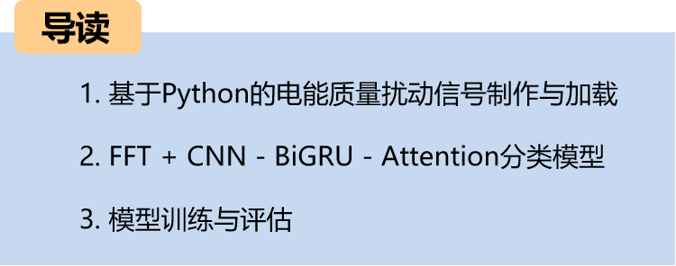
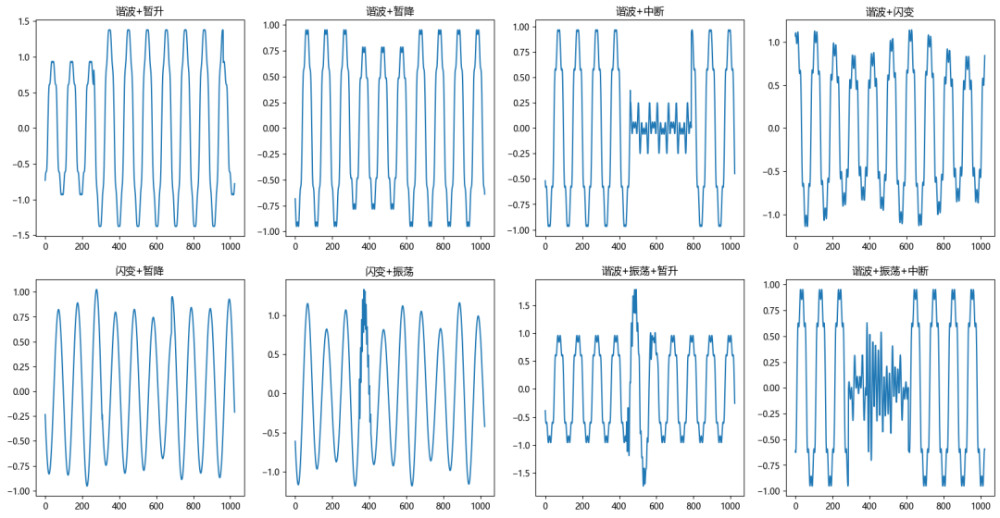
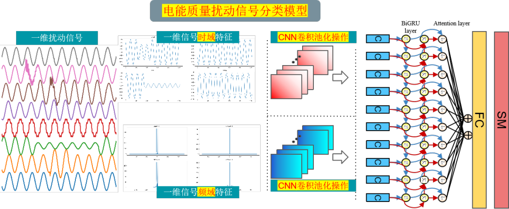
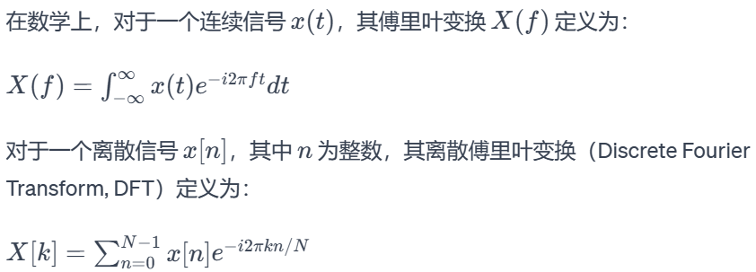

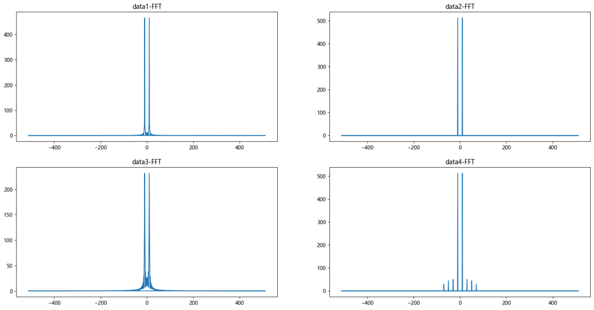

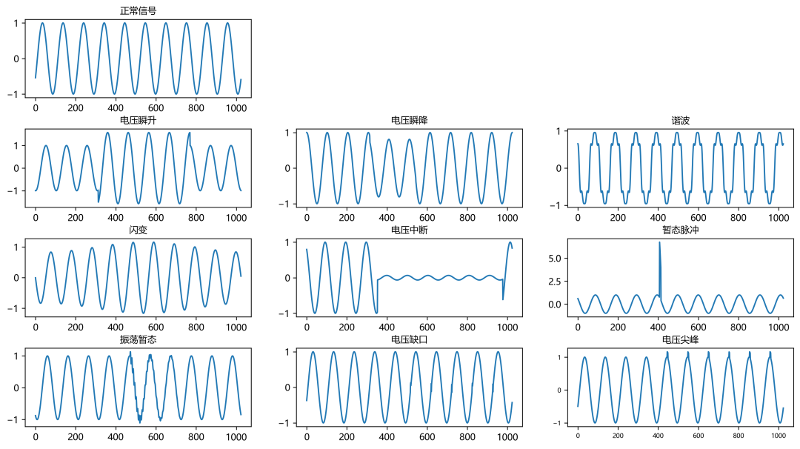
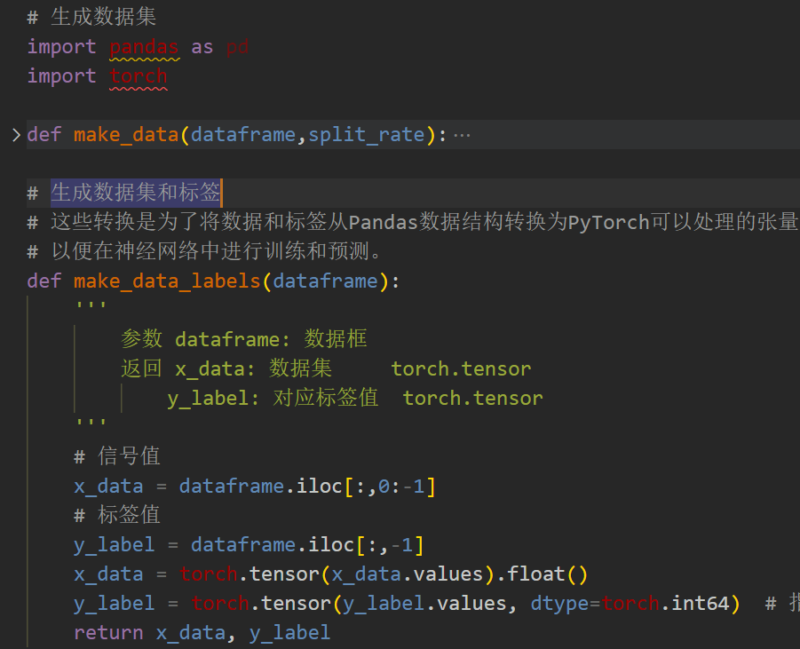

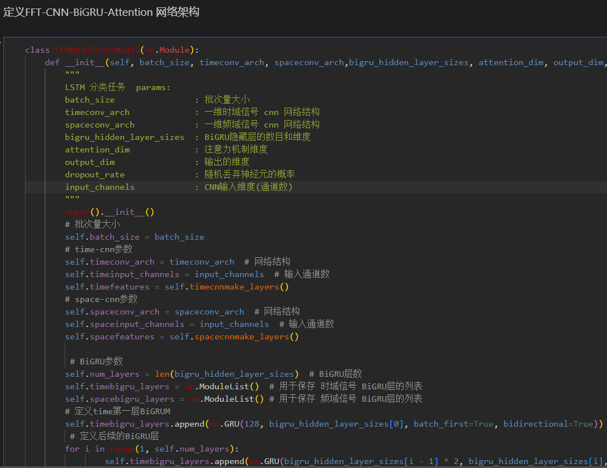
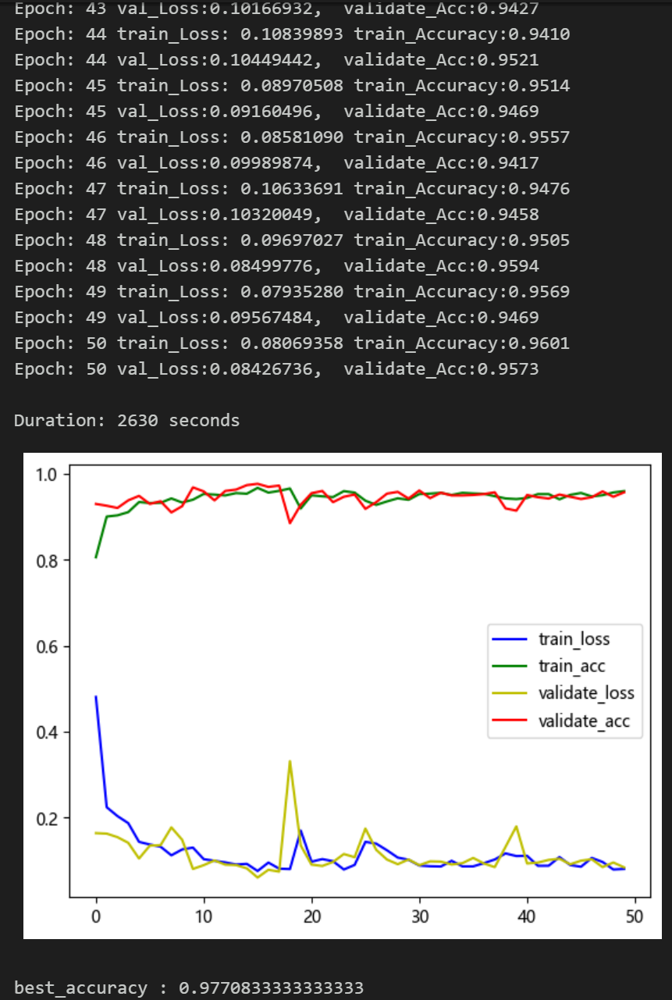
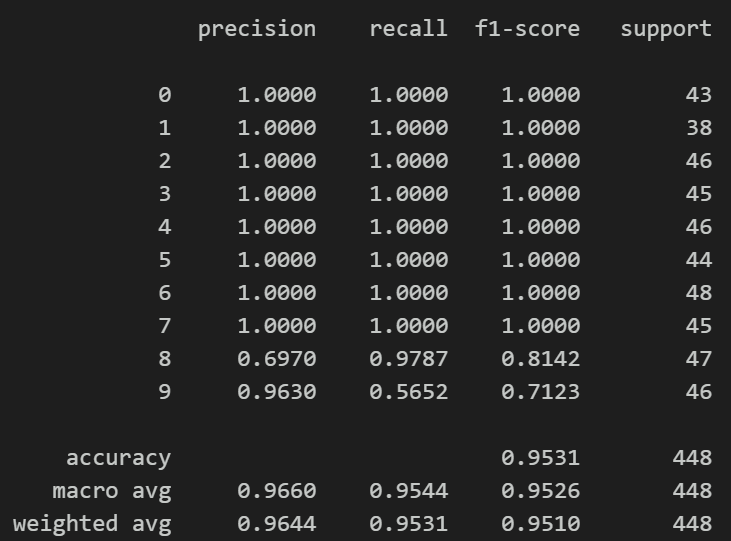
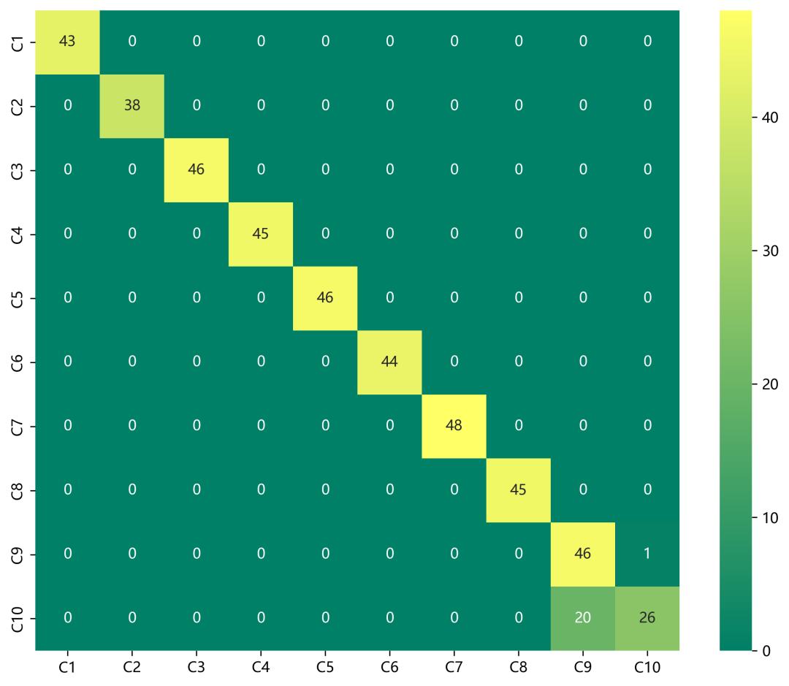
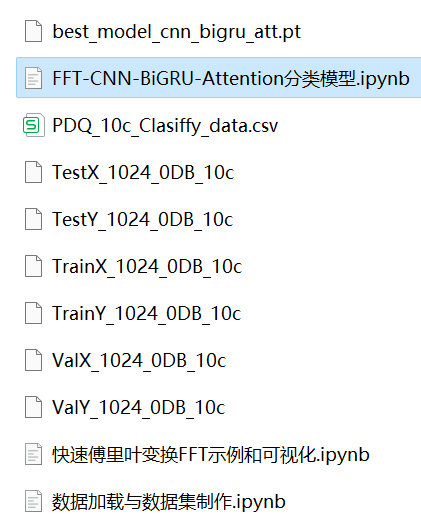

<!-- PAYMENT_BLOCK -->

## Get this dataset

- Payment link (Stripe): [Buy now](https://buy.stripe.com/3cs8yP7sY87d0vu9AB)
- Payment QR code: 

<!-- /PAYMENT_BLOCK -->
